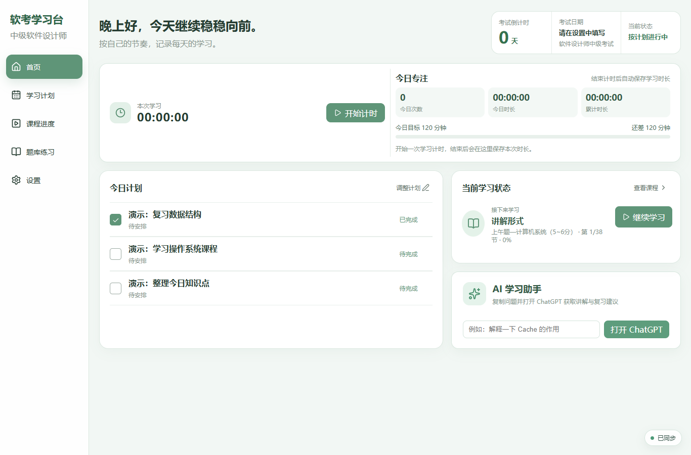
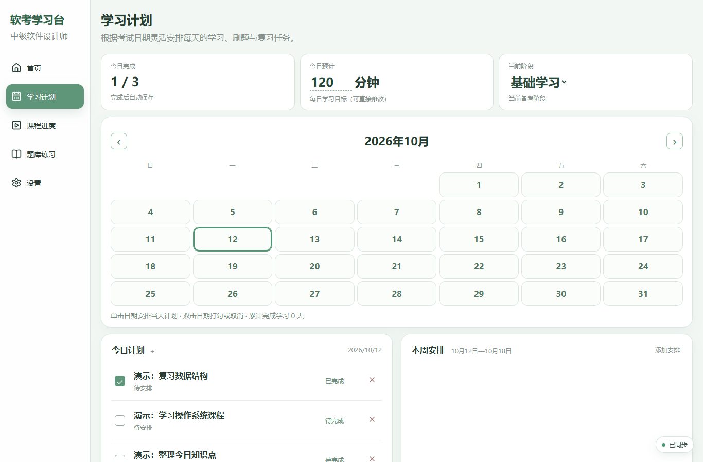
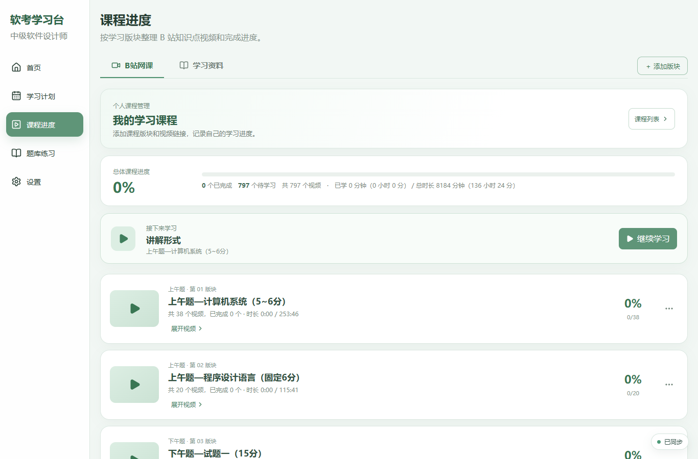
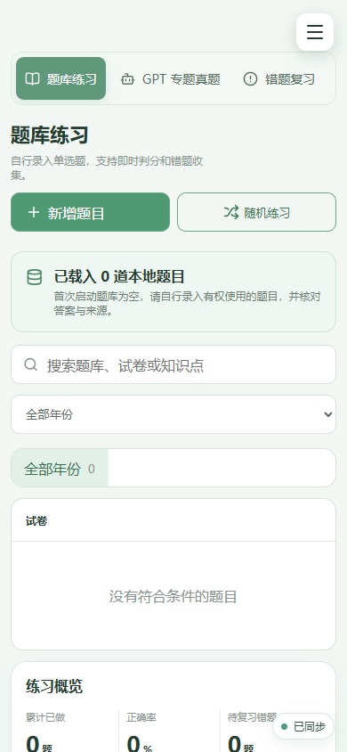

# 软考学习台（发布准备版）

本地运行的个人学习管理工具，使用 React、Vite、Python 标准库和 SQLite。
此目录是独立整理的发布候选副本，项目代码采用 MIT 许可证。

## 功能

- 日历计划：当天安排、未来预设、过去日期补记、历史记录。
- 历史未完成任务手动加入今天，按内容去重。
- 课程模块、视频链接和完成进度管理。
- 学习计时、手动单选题录入、练习、错题和文字/手写草稿记录。
- 本地资料目录扫描（目前按真题、专项练习等关键词筛选）。

不附带真题、解析、视频文件、个人数据库或 API 密钥。首次启动题库和学习记录为空。
内置 21 个课程板块、797 条 B 站视频标题、时长与公开链接，学习进度从零开始。视频在 B 站原页面播放，内容归原作者；链接可用性可能变化。首次加载时仅在尚无课程记录时填入目录，不覆盖已有课程；用户清空课程后也不会自动重新填入。

## 界面预览

以下截图来自独立演示环境；任务文字为演示数据，题库为空，不包含个人学习记录。

### 桌面首页



### 学习计划



### 课程进度



### 手机题库



## 环境与启动

- Node.js 22.12 或更高兼容版本（本机已用 Node.js 24.19.0 验证）。
- Python 3.10 或更高版本；后端无需安装第三方 Python 包。

在项目目录执行：

```sh
npm ci
npm run build
python server.py
```

macOS/Linux 若没有 `python` 命令，使用 `python3 server.py`。
打开 http://127.0.0.1:4183 。保持终端运行，按 Ctrl+C 停止。
修改前端后需要重新运行 `npm run build`。

## 配置

复制 `config.example.json` 为 `config.json`，根据需要设置端口和资料目录。
相对路径以项目目录为基准，绝对路径也支持；Windows 路径可以用 `/`。
默认资料目录是项目下的 `materials`，需要时自行创建并放入有权使用的资料。
`HOST`、`PORT` 环境变量分别优先于配置文件监听地址和端口。

默认绑定本机 127.0.0.1，面向单人使用，不提供公网登录和用户隔离。

### 手机通过局域网访问

在私人 `config.json` 中将 `host` 改为 `0.0.0.0`，然后重新启动 `python server.py`。
手机和电脑连接同一 Wi-Fi，手机浏览器打开 `http://电脑的局域网IPv4地址:4183`。
Windows 可运行 `ipconfig`，查看 WLAN 的 IPv4 地址；不要使用手机自己的 127.0.0.1 或虚拟网卡地址。
电脑需保持开机、服务运行。如果 Windows 防火墙询问网络访问，请仅允许受信任的专用网络。
局域网模式下，同网络可连接此服务的设备能够读写学习数据和调用本地接口，请仅在受信任网络使用，不要做公网端口转发。
电脑和手机共享后端数据，但仍应避免同时编辑；手机浏览器缓存和电脑缓存各自独立。
资料“打开”会调用服务器电脑上的默认软件，不能在手机上直接预览资料；其他系统的资料打开功能暂未实现。
AI 不是使用学习计划的前提。可选后端配置读取 `OPENAI_API_KEY`、`OPENAI_BASE_URL`、`OPENAI_MODEL` 环境变量；程序不会自动加载 `.env`。

## 数据与备份

首次启动自动创建 `data/soft-exam.db`。浏览器 localStorage 保存缓存和待同步队列。
使用固定的网址访问，localhost 与 127.0.0.1 的浏览器缓存彼此独立。
页面显示同步成功后停止服务，再复制整个 `data/` 目录作完整备份。
恢复时停止服务，将备份的 `data/` 放回，清理此应用网址的浏览器缓存后启动。
设置页 JSON 导出包含所有已同步应用状态与题库，包括课程、历史计划、专注记录和草稿；尚有待同步数据时会提示先同步。它不包含 API 密钥或外部资料原文件。目前没有通用的一键 JSON 导入恢复入口，恢复仍以 data 目录为准。
不要把 data、个人资料、日志、备份或 config.json 提交到 GitHub。

## 已知限制

- Chrome 已验证计划新增、勾选与刷新保存、历史补记、课程新增与刷新保存，以及跨午夜/跨周归档、预设计划启用、未完成任务顺延去重、手动录题、判分和错题保存。其他浏览器尚未验证。
- 首页旧原型的固定正确率和知识点掌握数字已移除；未提供知识点掌握度自动评估。
- 任务目前按文本识别，长期应改成稳定任务 ID；多标签页同时修改可能冲突。
- 历史归档不再按 60/24 组自动截断，仍受浏览器存储容量与每次 2 MB 请求限制；请定期备份。
- 当前手动录题和自动判分仅支持四选一单选题，不支持下午案例题、填空或代码题自动评分。
- GPT 专题新增用于登记专题信息，不会自动生成或导入题目。
- 不包含 PDF/OCR 自动导入工具，现有个人导入脚本未纳入发布包。

## 许可证

作者：[Miemie366](https://github.com/Miemie366)。项目代码采用 [MIT 许可证](LICENSE)。
第三方依赖保留各自许可证；B 站课程视频等第三方内容归原权利人，项目许可证不授予这些内容的使用权。
